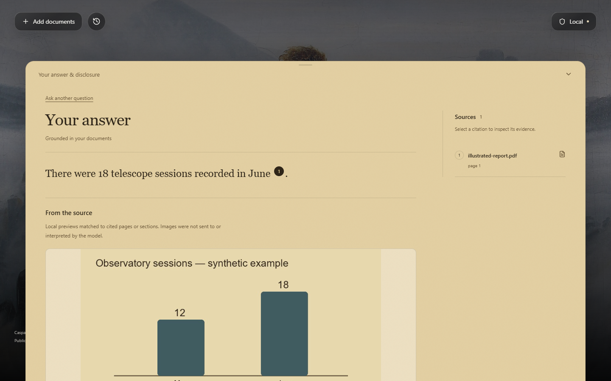
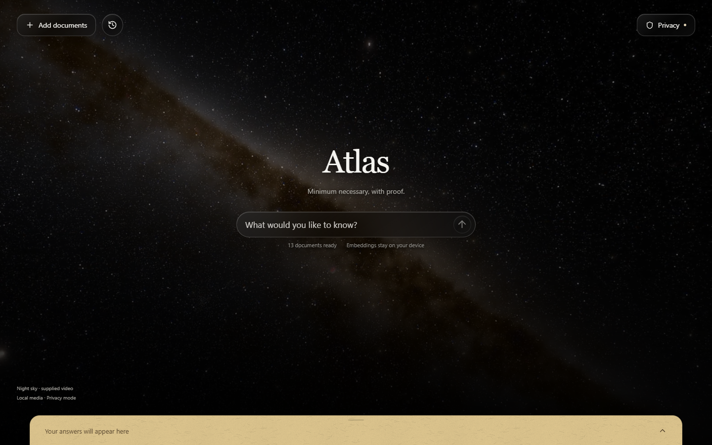
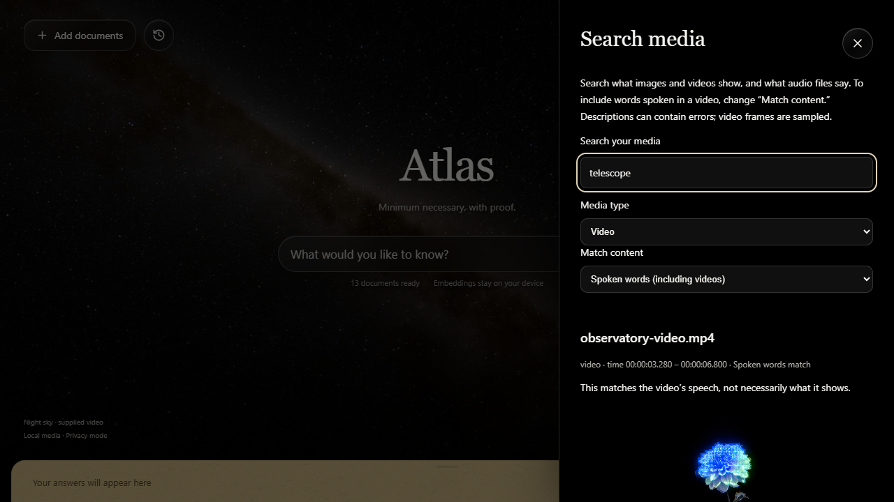
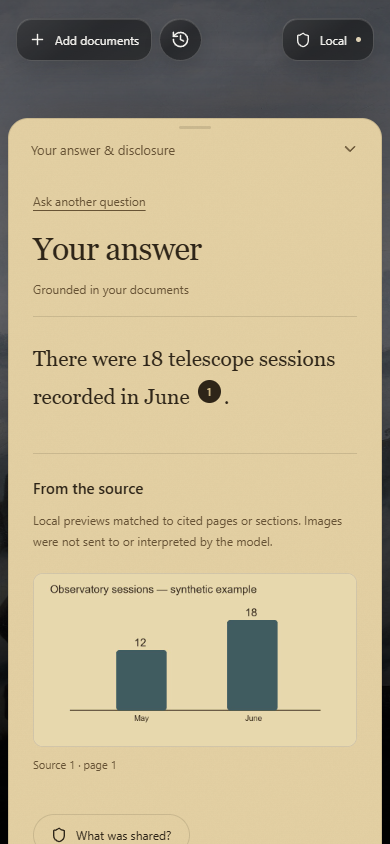

# Atlas

**Minimum necessary, with proof.** Ask questions across local PDF, DOCX, TXT, MD, CSV, XLSX and JSON documents. EmbeddingGemma 2 generates embeddings locally; embedded persistent Chroma plus SQLite BM25 provide local hybrid retrieval. Sentence-aware children retrieve bounded parents, and a local semantic extractive compressor selects evidence before the privacy pipeline. Inspect exactly what the application sends through Prune, and what it withholds.

## Working prototype

Screenshots captured from prototype sessions using demo sources. Backgrounds reflect the version shown.

### Document answers with source evidence



The demo answer cites the source PDF and shows its original chart. Embedded-document previews are displayed locally; this example does not demonstrate image understanding by the answer model.

### Privacy-mode workspace



The Privacy-mode start screen, with documents indexed for local retrieval.

<details>
<summary>See media search and the mobile layout</summary>

### Search spoken words in a video



This result matches the video's transcript. A speech match does not establish that the matched object appears in the video frames.

### Cited answers on mobile



</details>

## Run on this machine

In VS Code, open **`run.py`** in the project root and click **Run Python File**.
The launcher syncs dependencies, sets up missing embedding/NER models, builds the
frontend and opens Atlas in your browser. Keep the terminal open and press
Ctrl+C to stop. Python, `uv`, and Node.js/npm must already be installed. On first
run, add your Prune key to the newly created `.env` to use Privacy mode; local
generation also requires compatible local model assets or a loopback server.

Alternatively, run the setup commands directly:

```powershell
uv sync --python 3.12
uv run atlas setup-models
cd frontend
npm ci
cd ..
uv run atlas dev
```

Open **http://127.0.0.1:8765**. Port 8000 was already occupied by Unsloth; Atlas uses 8765. The single `atlas dev` command builds the UI, starts available local model servers, and starts FastAPI. `atlas serve` skips the frontend build.

The supplied Prune credential is in this checkout's **ignored `.env`**, not source control. For another checkout, copy `.env.example` to `.env` and set `PRUNE_API_KEY`. Gemini provider credentials stay in Prune's vault. No provider key belongs in this repository or browser bundle.

Use **Load demo data** in Add documents. Wait for files to become ready. Select a document to scope a question, or search all ready documents by leaving the selection empty.

## Local models: reuse Unsloth

The launcher detects the existing Unsloth llama.cpp runtime under `~/.unsloth/llama.cpp/build/bin/Release/` and cached `gemma-4-12B-it-qat-UD-Q4_K_XL.gguf` weights. It never downloads an LLM automatically.

- Generation: existing Gemma 4 12B, loopback port **8766**, explicitly offloaded to **CUDA0** when available. The launcher adds existing Unsloth CUDA DLLs to the child process search path; it does not change the machine-wide PATH. Missing CUDA falls back locally to CPU and logs that state.
- Embeddings: existing EmbeddingGemma 2 GGUF converted locally to **F32**, CPU inference with F32 KV types, loopback port **8767**. This text-only model has 768-dimensional outputs; vectors are validated and normalized.
- Conversion from cached F16 weights to F32 avoids FP16 runtime arithmetic but **does not recover any precision already lost in the source weights**. Retrieval quality must be measured. Source weights are left untouched.
- Without compatible cached GGUF/runtime assets, `setup-models` downloads the official SentenceTransformers model; unused vision/audio encoders are disabled during load. Inference uses BF16 where supported or FP32. No FP16 or remote embedding fallback.
- `ATLAS_LLAMA_SERVER` and `ATLAS_LOCAL_GGUF` override local binary/model paths. `ATLAS_LOCAL_BASE_URL` can point to another OpenAI-compatible **HTTP loopback** generation server. External destinations are rejected.
- Local NER uses spaCy `en_core_web_sm`. This environment obtained 3.7.1 from the official spaCy Hugging Face repository after the 3.8.0 release download failed. It loads under spaCy 3.8.18 with a compatibility warning; detector quality is not guaranteed. Standard setup attempts the compatible 3.8.0 model.

Model downloads and conversion are setup actions, outside the local-mode request audit. Both locally spawned servers are terminated when the app exits; existing servers are reused.

## Modes and disclosure

**Local** uses a local LLM directly. A deployable local Prune gateway was not established, so this is the explicitly documented exception to the hackathon's every-LLM-call-through-Prune rule. Local answers have no Prune signed receipt. The external request counter covers Atlas-owned generation requests for that answer's session; it is not machine-wide traffic monitoring or a privacy guarantee.

**Privacy** retrieves locally, removes unrelated sensitive fields/sentences, tokenizes needed values, asks consent, and calls Gemini through `https://api.withprune.com/v1/proxy/gemini/generateContent`. Prune sees the minimized request; Gemini free-tier data-use terms apply. Necessary values are restored locally in the answer. Identifying values can require consent even for a nonsensitive requested field, because the record relationship must remain consistent.

Consent expires after ten minutes or document/policy changes. Declining sends no generation request. The current UI permits tokenized use only; it does not offer raw sensitive-value overrides or real-document full-context overrides. Synthetic baseline evaluation is separately authorized by its explicit CLI flag.

Receipts show exact request bodies, withheld labels, local reveal, estimates, observed provider usage, original `prune_metadata`, and Ed25519 verification status. App minimization savings and Prune savings are separate. Prune's signature authenticates its metadata, not all application behavior. Provider billing is unverified; list-price equivalents are not bills or actual free-tier cash savings.

## Storage and limits

Everything persistent is under ignored `data/`: original uploads, SQLite text/provenance/history/budgets, Chroma vectors, payload audit, and model setup assets. `reports/` contains synthetic evaluation artifacts only; do not commit reports containing real user data.

Defaults: **100 MiB/file**, **1,000 PDF pages**, **250,000 table rows**, **50 MiB extracted UTF-8 text**, **512 MiB uncompressed DOCX/XLSX archives**, and a **15-minute parsing deadline**. MiB means 1,048,576 bytes. Limits are independent. Uploads are bounded while receiving and while copying file bytes. Parsing is cancellable and indexing batches eight chunks. Scanned PDFs need OCR, which is not implemented.

Defaults are in `config/app.toml`; override numeric settings through `ATLAS_` plus uppercase key (examples in `.env.example`). Larger uploads do not increase cloud prompt budgets: approximately 2,048 context tokens, 512 output tokens and 50,000 reserved session tokens. The local UTF-8-byte token estimator is not a Gemini tokenizer or a formal upper bound.

Generic table sums, averages, minima, maxima and counts run locally. Select explicit documents to avoid counting CSV/XLSX duplicates twice. Calculations require plain numeric values and at most 10,000 chunks. General date arithmetic, joins and arbitrary analysis are not implemented.

Delete this file removes its vectors and original/text content, and clears history/audits that could contain derived information. Delete-all also clears reports and remaining application records. Downloaded models remain installed. Deletion is not a forensic secure-erase guarantee. Backups and SSD behavior are outside the app's control.

## Test and evaluate

```powershell
uv run pytest -q
uv run atlas eval
uv run atlas eval --live --synthetic-full-context --resume
```

Offline evaluation exercises minimization over 36 generated gold cases. It is **not** measured LLM accuracy, a real outbound canary test, or paid savings. Live evaluation requires indexed demo documents and uses actual local Chroma retrieval for the pipeline arm. It inspects audited serialized requests, compares against the full synthetic source baseline, scores deterministic expected answers, preserves receipts, and saves `reports/evaluation.json` and `reports/evaluation.md` after each request.

Live evaluation runs serially with bounded requests/tokens and pauses on quota exhaustion. Rerun with `--resume` to keep completed results. No paid fallback or LLM judge. Gold-manifest sensitive cases authorize tokenized use on generated fixtures. Actual free-tier availability is controlled by the user's provider account, not by the app.

Accuracy uses expected fact substrings; citation validity is checked on interactive answers but is not yet part of the gold correctness score. The harness reports incomplete runs honestly. Cache is off by default; the adapter supports `cache='exact'` for a separate synthetic repeat experiment. No separate cache benchmark has been completed unless explicitly present in reports.

## Reliability and limitations

Requests reserve session budgets atomically. The exact body is persisted before dispatch; audit-write failure blocks dispatch. Shield rejection is terminal. Only connection failures have bounded retries; read timeouts do not retry an ambiguously dispatched request. Cloud generation never bypasses Prune. The backend binds to loopback and rejects unexpected browser origins.

Retrieval and sensitivity detectors can miss information. Regex/NER/field heuristics are not comprehensive classification or legal compliance. Semantic selection is heuristic, and the app can abstain or answer incorrectly. Prompt injection defenses are instruction separation and constrained evidence, not a guarantee. There is no OS-level sandbox for model servers or parsers. Gemini free quota and Prune availability can prevent evaluation completion. The painting uses slow CSS transforms rather than a WebGL swirling shader; reduced motion and hidden-tab pause are supported. Performance must be measured on the target machine.

See [PLAN.md](PLAN.md), [demo script](docs/demo-script.md), [pitch](docs/pitch.md), and the [artwork attribution](frontend/public/ATTRIBUTION.txt).


## Retrieval upgrade and source navigation

Original prose chunks were 300-word windows with 40-word overlap; table rows stayed intact. The current default preserves sentence boundaries, targets at most 240 words per child, retains a short sentence overlap, and stores bounded prose parents (around 900 words). JSON/table rows are never merged with other records. PDF page boundaries are retained. Long individual sentences are still bounded.

- **Hybrid search:** local Chroma dense candidates and SQLite FTS5 BM25 candidates are fused using reciprocal rank fusion (k=60), with ready-state/document scope filtering before returning evidence.
- **Parent-child retrieval:** search small child vectors, deduplicate parents, and expand their text locally. Parent expansion never automatically sends a parent to the cloud; the existing privacy and prompt-budget gates still apply.
- **Contextual compressor:** local embedding similarity plus lexical relevance ranks sentences globally. It extracts original spans rather than generating summaries; short antecedent context is retained for pronoun-led sentences. No additional LLM calls or paid inference.
- **Semantic chunking:** an optional `ATLAS_SEMANTIC_CHUNKING=true` enables local embedding-based topic breakpoints during indexing. It remains off by default because the measured stress cases showed no incremental coverage over sentence-aware boundaries.
- **Late chunking:** not implemented. The current GGUF embedding endpoint returns pooled vectors, while late chunking needs token-level contextual embeddings and pooling by span. No measured benefit justified replacing that runtime.

Run `uv run atlas reindex` while the app/local embedding server is running to rebuild existing indexes without deleting original uploads or prior receipts. New uploads use the new strategy automatically. Prior history preserves its embedded evidence; old chunk links can expire across reindexing, while original-file links remain available until deletion.

`uv run python -m atlas.retrieval_benchmark` reproduces the eight manufactured boundary/rare-ID stress fixtures. See `reports/retrieval-before.json`, `reports/retrieval-after.json`, `reports/retrieval-stress.json`, and `reports/compressor-check.json`. These are retrieval and evidence-retention measurements, not a fresh generated-answer accuracy evaluation. The earlier 72-call cloud evaluation remains a historical result for the preceding implementation.

Answer citations are keyboard-accessible links to local evidence cards. Each card opens the original local file; PDFs include a page anchor. File IDs are resolved through the local registry and paths are restricted to the uploads directory. The UI uses OLED-black panels, static glass materials, a compact focus-expanding search bar, and a textured paper answer surface. Scroll/wheel or drag the answer handle to reveal it; scroll its contents normally, or reverse at the top to dismiss. Background zoom follows scroll intent, pauses when hidden, and respects reduced motion. No fresh compositor-FPS claim is made.


## Source images and mode-aware backgrounds

Atlas displays local previews from embedded PDF, DOCX and XLSX images alongside cited answers. PDF pages containing vector drawings can provide an explicitly labelled page preview. Previews are matched by cited page, paragraph range or spreadsheet image-anchor row; this is **not semantic image retrieval or image understanding**. The embedding model and cloud answer model receive text only. Standalone uploaded images/video can be described by local Gemma 12B as detailed below; embedded-document previews are not automatically analyzed. Image-only documents can expose their local previews, but their contents are not OCR-transcribed or analyzed.

Previews are normalized to JPEG, bounded to 2048 pixels on the longest edge, capped at 40 per source, 20 million decoded input pixels per image, and 24 MiB total preview storage. Limits live in config/app.toml. Previews and their manifest live under the ignored uploads/media directory. File deletion removes them; missing/deleted source IDs return 404. Existing history can resolve newly indexed previews through local source IDs. External Office image relationships are skipped; web image links are never fetched. Office vector objects and native spreadsheet charts are not rendered.

New uploads index images during their bounded parsing worker. To add previews to existing ready documents without re-embedding, run:

```powershell
uv run atlas index-images
```

The included illustrated-report.pdf is a synthetic chart example. Select it and ask “How many telescope sessions were recorded in June?” to see its original embedded chart with the cited text answer.

The product display name comes from config/app.toml and is now **Atlas**. Side panels animate in and out over 240 ms; the paper is warmer brown/mustard. Privacy mode crossfades to the supplied night-sky video, with a static first-frame poster for reduced motion. Local mode crossfades every 18 seconds among a 1662 Blaeu world map, Wanderer above the Sea of Fog and Water Lilies, retaining the texture of the original public-domain reproductions. Mode/gallery fades take 0.9 seconds. Artwork attribution is in frontend/public/ATTRIBUTION.txt. Reduced motion stops autoplay and uses the static poster; visibility handlers pause playback/rotation when hidden. Backgrounds are served locally, never hotlinked.

See reports/SOURCE-IMAGES-AND-BACKGROUNDS.md for measured validation. Prior evaluation reports remain historical; no new cloud-answer accuracy or cost claim is inferred from this feature.


## Uploaded image, video and audio search

Upload PNG/JPEG/WebP/GIF images; MP4/WebM/MOV/MKV videos; and WAV/MP3/M4A/OGG/FLAC/AAC audio through **Add documents → Upload files**. **Search media** opens local semantic search with image/video/audio filters, previews, timestamped text and local playback. The main ask bar can also answer using indexed media text.

- **Images:** cached Gemma 4 12B and its local vision projector generate a short visual description. GIFs use the first frame. Captions can miss or invent details and are labelled machine-generated, not verified OCR.
- **Video:** at most eight frames are sampled over a clip; Gemma describes those frames locally. Speech is transcribed locally if present. This does not inspect every frame or provide exhaustive action recognition.
- **Audio:** the selected local Whisper model produces speech transcripts with approximate timestamps bounded to clip duration. Audio search is speech-based; it does not identify arbitrary music or sound effects.
- Captions/transcripts are embedded using the same local text-only EmbeddingGemma 2 and indexed in local Chroma/SQLite. This is caption/transcript search, not direct pixel or acoustic-vector retrieval.
- Raw media and previews are not sent to Prune. In Privacy mode, selected caption/transcript text can be sent only through the normal minimization/consent pipeline. Local caption requests are audited and use the documented local-Prune-routing exception.
- Limits: 100 MiB uploads, 15-minute clips, up to eight sampled video frames. Media processing shares the existing supervised parser deadline. **Retry indexing** is available after setup failures or cancellation. Browser playback depends on installed codec support; original local files can still be opened/downloaded.

One-time speech setup (local model assets; no paid ASR service):

```powershell
uv run atlas setup-media
```

The existing 12B GGUF and `mmproj-F16.gguf` are reused. Generation uses CUDA0 with a 4096-token context and Q8 KV cache; the projector is kept on CPU to preserve GPU headroom. The F16 projector is not the embedding model: EmbeddingGemma 2 inference remains FP32 on CPU. `ATLAS_LOCAL_GGUF`, `ATLAS_LOCAL_MMPROJ`, and `ATLAS_LOCAL_MODEL` can override local assets; keep the model label consistent with the actual GGUF. Media captions and ordinary local answers now use `gemma-4-12B-it-qat`.

The `faster-whisper` release requires a compatible PyAV; this project pins PyAV 16.x after testing revealed the removed `metadata_errors` argument in PyAV 19. Models load from local files at runtime. If `uv sync` removes the separately installed NER wheel, `atlas setup-models` now reuses its cached local wheel.

Reindexing while the app is running delegates to its owning process (`POST /api/reindex`), avoiding cross-process embedded-Chroma writers. `atlas reindex --document-id ID` can rebuild just one source. Keep the app running for CLI reindexing so its embedding server is available.

## Current background and paper behavior

The first Local scene is a high-resolution Joan Blaeu world map (1662), replacing Van Gogh in the carousel. Rotation is now **18 seconds**, with **900 ms** crossfades—half the previous interval and fade time. Privacy now uses only the supplied night-sky video; the flower scene and its active asset have been removed. Reduced motion stops automatic cycling/video. The search bar changes width only; its height remains 52 px. The paper now uses a more visible neutral fiber texture blended with the warm paper theme.

See reports/GEMMA12B-MULTIMODAL.md for measured checks. Earlier reports describe earlier implementations and were not reinterpreted as new accuracy/cost measurements.


## Contextual retrieval

Atlas now enriches the **local index** with bounded, extractive document/section context before both vector embedding and BM25 indexing. This is distinct from the existing contextual compressor and parent-child retriever. The context includes a local document title, source location, existing section opening or table field names. It is capped at 80 words and requires **no extra LLM calls**. It is not an LLM-generated document summary.

Original chunk text, source IDs, citations and history remain unchanged. Index context is stored separately in local SQLite and is used for local search/reranking only; it is never automatically added to model evidence. Exact multiword source-name matches can narrow ambiguous retrieved documents. The existing privacy/consent pipeline still processes original evidence.

New uploads use context automatically. Existing indexed files were updated in the owning app process without reparsing or regenerating media captions/transcripts. For maintenance, POST to `/api/retrieval/contextualize` while the app is running. See reports/CONTEXTUAL-RETRIEVAL.md and the reproducible `uv run python -m atlas.contextual_benchmark` stress ablation. The narrow stress improvement is not a fresh generated-answer accuracy score.

Privacy mode now has **video only**, with a static video poster for reduced motion. Local mode's painting/map carousel is unchanged.


## Answer explanations and PDF layout

Overview questions now request a direct definition plus a short explanation of mechanism/purpose, usually 80–140 words when supported. This is a soft style target, not a mandatory minimum; factual lookups remain brief. Unsupported questions still identify the missing evidence rather than filling gaps from model knowledge. The 512-token output cap is unchanged.

PDF soft line wraps no longer become separate sentences during compression. Blank lines remain paragraph boundaries; original source spans/offsets remain available. Unicode ligatures and CamelCase are normalized for term matching, without guessing missing font glyphs or rewriting original evidence. The compressor favors substantive passages over title fragments and reduces dense benchmark-table selection for overview questions. Existing indexed parents benefit at query time; re-uploading PDFs is not required.

Citation groups such as [S1, S2] are validated and rendered as individual clickable sources. Numerical arrays remain plain text. See reports/ANSWER-QUALITY.md for measured regression checks; no broad generated-answer accuracy claim is made.

## Local voice dictation and Indian-language search

The microphone beside either search bar records a question locally. Click it to start, click Stop to transcribe, then review/edit the text. The arrow beside the microphone opens language settings. The document question is submitted only when you press Ask; dictated media queries wait for **Search reviewed text**. Dictation switches document questions to **Local** mode, which is also the default for the UI and API. Privacy mode remains an explicitly selectable cloud feature; selecting it later sends approved minimized text through Prune as before.

Dictation uses **local multilingual Whisper on CPU/int8**. A complete installed large-v3-turbo model is preferred over base; an explicit `ATLAS_SPEECH_MODEL_DIR` takes precedence. The current quality upgrade installs large-v3-turbo on this machine. It uses `getUserMedia`/`MediaRecorder`, **not** a browser speech-recognition service. Audio is posted only to the loopback Atlas backend, decoded and transcribed in a supervised local worker, then deleted with its temporary transcript file. It is not added to sources, history, Git, or the LLM audit. Submitted questions retain the existing local history/audit behavior. A browser microphone permission is required; no capture starts before you click. Cancel/unmount stops microphone tracks. Limits: 60-second recording, 8 MiB upload, one transcription worker, 150-second processing deadline. Runtime never downloads speech assets; incomplete model/tokenizer assets fail with a setup message.

Use `uv run atlas setup-media` once to install the quality model (large-v3-turbo); `uv run atlas setup-media --speech-model base` installs the smaller base model. If both are installed, use the model-directory override to force base. To reuse a better **already downloaded, multilingual CTranslate2/faster-whisper** model, set `ATLAS_SPEECH_MODEL_DIR` in `.env` to its complete local folder (weights, config, tokenizer and vocabulary) and restart Atlas. GGUF LLM files cannot serve as Whisper speech models. A larger compatible speech model still runs on CPU, with additional RAM/time. Base-versus-turbo synthetic timings are in `reports/DICTATION-QUALITY.md`; other models and real-accent accuracy were not benchmarked. The quality model is a one-time download; transcription itself uses complete local assets with no download fallback.

Language settings offer auto-detection, English, Hindi, Bengali, Tamil, Telugu, Marathi, Gujarati, Kannada, Malayalam, Punjabi, Urdu, Assamese, Nepali, Sanskrit and Sindhi. Select a language for short utterances when auto-detection struggles. These are Whisper-supported decoding options, **not a claim of equal accuracy**. Dialects, code-switching/Hinglish, names and noisy audio can be transcribed incorrectly. Indian-language speech accuracy has not been measured in this build.

Type native-script queries directly: the existing local EmbeddingGemma 2 can retrieve across languages without a translation API or new index. Indic combining marks are preserved during term matching, and the local answer prompt requests the question's language. Romanized Indian languages and mixed-language queries are best effort. Sensitive-field/table matching still relies partly on field names and local English NER; cross-language questions can miss those fields. No privacy detector was relaxed to broaden retrieval.

Measured checks are in `reports/LOCAL-VOICE-AND-LANGUAGES.md` and `reports/local-voice-multilingual.json`. In the narrow native-script media sample, eight of ten Indian-language queries found the intended flower media; the Gujarati and Urdu queries missed. English, Hindi and Tamil document questions returned the expected 24-day fact from the English source. These are regression examples, not a multilingual accuracy benchmark.

Media search now defaults to visual descriptions for video/images and speech for audio files. **Match content** explicitly enables video speech or all content. Matches identify their content type, use relevance gates and show one strongest timestamp per file/type. See `reports/MEDIA-SEARCH-FIX.md` for the telescope/flower regression.


## Microphone and dictation quality

Open the arrow beside the mic, choose the actual **Microphone**, then use **Check microphone**. Its live meter and active device label let you check the selected input before dictating. This check stops after 15 seconds and sends no audio to the backend. A disconnected selected device produces an error; Atlas does not silently switch to another mic. Device, language, processing and optional vocabulary preferences are stored only in this browser.

For English / Indian English, select **English** (the default for new settings). Existing explicit language choices are preserved. Wait for **Listening** before speaking so permission/device startup does not cut off the first word. Recording requests mono audio, browser echo/noise reduction and automatic gain, with 128-kbit/s Opus where supported. **Raw input** disables browser processing if those filters distort your particular microphone. Browser/device support varies.

Under **Vocabulary & microphone processing**, add a short optional list of names such as `DreamDiffusion, Prune`. Hints go only to local Whisper and can bias recognition; they are not a guarantee of correct spelling. Dictation does not use an LLM to rewrite what you said. The backend removes DC offset, applies at most 18 dB of gain to quiet input, preserves speech padding around detected utterances, and rejects near-silence or very unclear transcripts. It reports quiet/clipped input and uncertain words for review.

Run `uv run python -m atlas.voice_benchmark` for the local before/after synthetic-English regression (requires both local base and turbo models). This is not an Indian-accent accuracy benchmark. Measured results and resource/quality limits are in `reports/DICTATION-QUALITY.md`.
