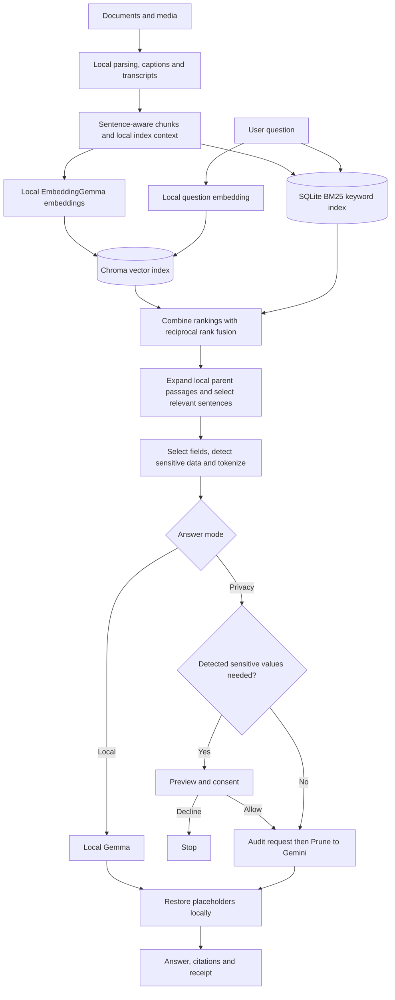

# Atlas Privacy RAG: Concise Project Guide

## What is the project?

Atlas lets users ask questions about local documents and media while reducing the information sent to a cloud model. It searches and processes evidence locally, then offers two modes:

- **Local:** a local Gemma model generates the answer.
- **Privacy:** selected, processed evidence goes through the Prune proxy to Gemini.

**RAG (Retrieval-Augmented Generation)** means finding relevant source material first, then giving it to a language model to answer from. Citations help users inspect the source.

## Architecture



## How does it work?

1. **Ingest:** Atlas extracts text and source locations from PDF, DOCX, TXT, MD, CSV, XLSX and JSON. It can also index locally generated image/video descriptions and speech transcripts.
2. **Chunk:** It divides prose into sentence-aware child chunks, with larger bounded parent passages for context. Table and JSON records stay separate.
3. **Index:** It adds a short local context prefix, such as a title or section opening. EmbeddingGemma converts text into numerical **embeddings** for Chroma; SQLite FTS5 indexes words for keyword search.
4. **Retrieve:** For a question, semantic search finds similar meanings and BM25 keyword search finds matching terms. **Reciprocal rank fusion** combines their rankings. Atlas expands useful parents locally.
5. **Compress:** It selects original sentences using semantic and word-overlap scores. This is **extractive compression**: choosing source text, not generating a summary.
6. **Minimize:** It selects relevant fields or sentences, withholds unrelated material, and replaces detected sensitive values with placeholders.
7. **Generate:** Local mode uses Gemma on the computer. Privacy mode sends the processed request through Prune to Gemini, after consent when detected sensitive values are needed.
8. **Return:** Atlas restores recognized placeholders locally and displays the answer, citations and request receipt.

## How do we decide what to hide or send?

Atlas checks **relevance** and **sensitivity**:

| Information | Treatment |
| --- | --- |
| Unrelated field or sentence | Withheld |
| Relevant, detected sensitive value | Replaced with a random placeholder; Privacy mode asks for consent |
| Relevant, apparently nonsensitive text | Included if it fits the context budget |

For structured records, field names are compared with the question; values explicitly mentioned in the question can identify the matching record. For prose, the compressor chooses relevant sentences. Detection combines policy field names, regular-expression patterns, custom patterns and local spaCy **named entity recognition** (NER: detection of people and places in text).

For example, when asking for an employee's department, Atlas may replace the employee's name with the same placeholder in the question and record, send the department, and withhold salary and email. It restores the name locally after generation. A name can require consent even when the requested department is not sensitive, because it identifies the record.

**Limits:** these are heuristics. A sensitive value can be missed, and surrounding context can identify someone even after a name is replaced. Tokenization is reversible pseudonymization, not guaranteed anonymity. Consent is requested only when the system detects sensitive categories as needed; declining sends no generation request. Consent expires after ten minutes or a document/policy change.

## Other implemented features

- **Citations:** source IDs link answers to local evidence. Unknown IDs are flagged, but a valid ID does not prove that the source supports the claim.
- **Receipts:** show the serialized request, withheld labels, usage and Prune metadata. An Ed25519 signature can authenticate Prune metadata; it does not prove complete privacy or answer correctness.
- **Local calculations:** sum, average, minimum, maximum and count run locally over explicitly selected documents, within implementation limits.
- **Media:** local Gemma captions images and up to eight sampled video frames; local Whisper transcribes speech. Search uses the resulting text, not direct image or audio vectors. Raw media is not sent to Prune for answers.
- **Guardrails:** context and session budgets, local request audits, bounded parsing, prompt instructions to treat document content as untrusted, and an abstention response when no usable evidence is found.

Local generation bypasses Prune: this is a documented exception, and local calls do not have Prune signed receipts. Cloud generation goes through Prune. The external-request count covers Atlas-owned session requests, not all machine traffic.

## How to run it

Requirements: Python 3.12, `uv`, Node.js/npm, sufficient local model resources, and a Prune key plus configured Gemini provider for Privacy mode. Local generation also needs compatible model/runtime assets or an OpenAI-compatible HTTP server on loopback; setup does not automatically download the generation LLM.

```powershell
cd C:\path\to\Privacy-RAG
uv sync --python 3.12
uv run atlas setup-models
Copy-Item .env.example .env
# Set PRUNE_API_KEY in .env for Privacy mode.
cd frontend
npm ci
cd ..
uv run atlas dev
```

Open <http://127.0.0.1:8765>, choose **Add documents → Load demo data**, wait until indexing finishes, select a mode and ask a question. Inspect the consent preview, citations and receipt. For audio setup, run `uv run atlas setup-media`.

```powershell
uv run pytest -q                              # Tests
uv run atlas eval                            # Offline minimization checks
uv run atlas eval --live --synthetic-full-context --resume  # Live synthetic paired evaluation
```

The live evaluation requires indexed demo data and a working cloud configuration; it sends synthetic baseline and pipeline requests. See [README.md](../README.md) for configuration, model overrides and limits.

## Important evaluation metrics

| Metric | What it tells us | Recorded result or status |
| --- | --- | --- |
| Answer correctness | Whether the answer contains the expected fact | Historical live run: baseline 36/36; pipeline 35/36. Substring scoring is limited. |
| Evidence retention / Recall@k | Whether required evidence is retrieved and retained | Later local checks retained expected facts on 36 existing gold cases; not a fresh cloud answer score. |
| Sensitive-data leakage | Whether prohibited values appear in outbound requests | Historical run: 0 unrelated synthetic canary occurrences across 36 pipeline requests. |
| Detector precision and recall | False alarms and missed sensitive values | Important future measurement; no broad score established. |
| Context reduction | How much source context is withheld | Historical mean 89.69%, estimated with a byte-based method, not the Gemini tokenizer. |
| Provider token usage | Observed input/output model tokens | Historical input: 28,424 baseline vs 6,817 pipeline, 76.02% fewer. Output: 529 vs 993. |
| Cost | Estimated or actual spending | Historical paid-list-price equivalent was 54.03% lower; actual billing and free-tier cash savings were not verified. |
| Citation support | Whether a cited passage supports a claim | Citation IDs are checked; full claim-to-source support is not part of the historical gold score. |
| Latency and reliability | Speed, failures and useful abstentions | Measure on representative hardware and workloads; isolated smoke tests are not broad benchmarks. |

The 72-call cloud evaluation describes an **earlier implementation**. Its one failed case passed a separate retest after a fix, but the complete run was not repeated. Later retrieval changes have narrower tests. Synthetic canary results do not prove universal privacy. See [MEASURED.md](../reports/MEASURED.md) and [CONTEXTUAL-RETRIEVAL.md](../reports/CONTEXTUAL-RETRIEVAL.md).

## Likely judge questions

**What problem are you solving?**  
People want answers from their documents without unnecessarily sending whole documents and unrelated sensitive fields to a cloud model.

**Why RAG?**  
It supplies relevant source evidence at question time and supports citations, instead of relying only on a model's general knowledge. Retrieval and generation can still be wrong.

**Why hybrid search?**  
Embeddings find related meanings; BM25 finds exact words and identifiers. Reciprocal rank fusion combines their result rankings.

**Why parent and child chunks?**  
Small children help search precisely; larger parents provide surrounding context locally. Parents are not automatically sent to the cloud.

**How do you protect sensitive data?**  
We select relevant evidence, withhold unrelated material and replace detected sensitive values with placeholders. Privacy mode asks for consent when detected sensitive values are needed. Detection can miss values.

**What happens if the detector misses a name?**  
The name could be sent if the selected evidence contains it. Multiple detectors, minimization and a preview reduce exposure but do not guarantee protection.

**What does Prune do?**  
Prune proxies cloud generation and supplies metadata and potentially a signed receipt. Atlas performs the local retrieval, minimization, consent and restoration. Local model calls bypass Prune as a documented exception.

**Is the system completely private?**  
No. Detection is imperfect, and context can reveal identity. Privacy mode sends processed text to Prune and the configured cloud provider. Local mode uses a local generation endpoint, within the scope of the application's checks.

**How do you know an answer is grounded?**  
The model is instructed to use supplied evidence and cite source IDs; users can open the sources. Valid IDs alone do not prove that a source supports a claim.

**How do you handle prompt injection?**  
The prompt treats document text as untrusted evidence and tells the model not to follow instructions inside it. This is a mitigation, not a guarantee.

**What were your results?**  
In a historical synthetic paired run, pipeline correctness was 35/36 versus 36/36 for full context, with 76.02% fewer observed input tokens and zero unrelated canary occurrences in 36 pipeline requests. Later changes need a fresh end-to-end evaluation.

**Did you save 76% of cost?**  
No. That is the input-token reduction. The historical list-price equivalent was 54.03% lower; actual billing was not verified.

**What would you improve next?**  
Run a fresh end-to-end evaluation; measure detector recall and real outbound leakage on a broader labeled dataset; assess citation support, abstention and prompt injection; and benchmark latency across hardware.

## Key limitations

Sensitive-data detection, retrieval and generated answers are imperfect. Placeholder substitution does not ensure anonymity. Scanned PDFs lack OCR; video uses sampled frames; captions and transcripts can be wrong. Deletion is not forensic secure erasure. The parser and model servers do not have an OS-level sandbox. Historical synthetic results should not be generalized into a privacy guarantee.
